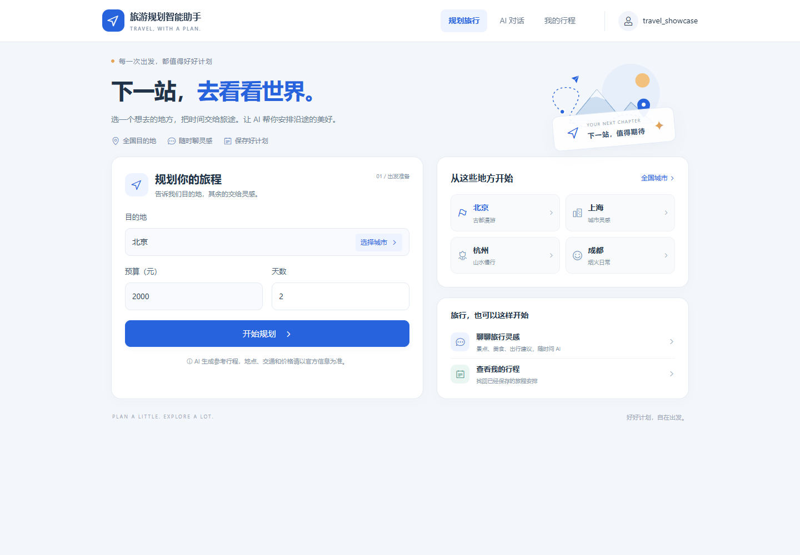
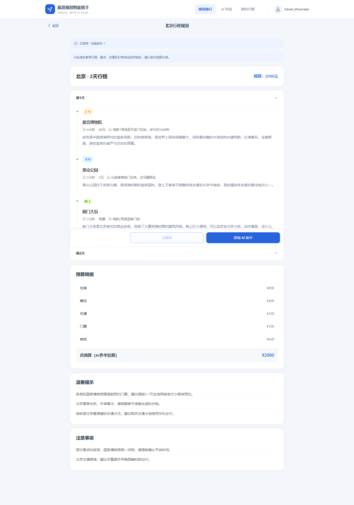
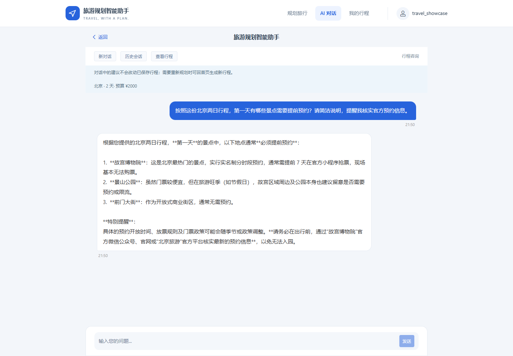
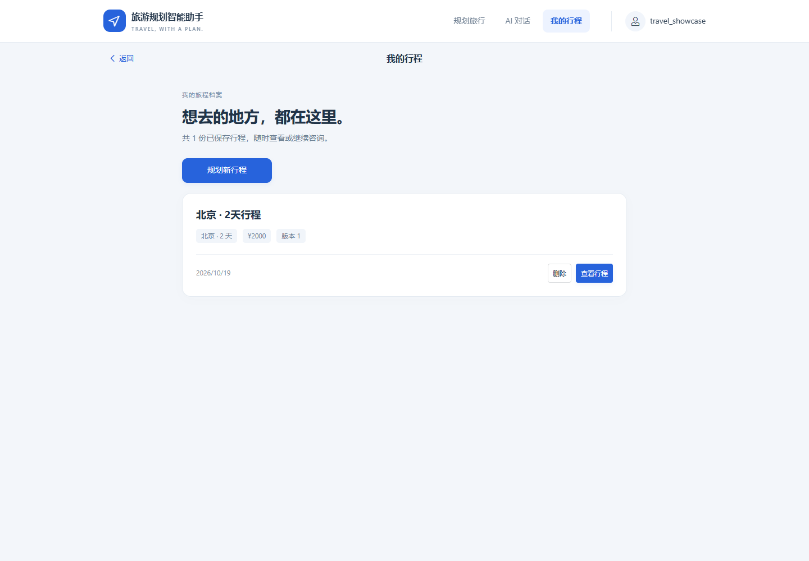

# 旅游规划智能助手

面向自由行用户的 AI 旅行规划应用。输入目的地、天数和预算，生成按天、按时段组织的行程，确认保存后继续围绕行程进行多轮咨询。

**技术栈：Java · Spring Boot · Spring Security · MyBatis · MySQL · Vue 3 · TypeScript · Qwen API · SSE · Docker Compose**

## 页面展示

截图使用独立演示账号，展示北京两日、预算 2000 元的实际规划与关联咨询。

### 规划首页


### 行程安排


### 关联行程的 AI 咨询


### 我的行程


## 主要功能

- **行程规划**：输入城市、天数、预算，调用 Qwen 生成结构化行程；校验输入条件与每日早、中、晚安排后展示。
- **行程保存**：用户确认后写入 MySQL，支持行程列表、历史版本读取与关联会话咨询。
- **多轮咨询**：SSE 流式显示回答，结合近期成功问答与行程摘要组织上下文；支持停止生成、确认停止后重新发送。
- **账号隔离**：Spring Security 管理登录会话，按账号查询行程与消息，使用 CSRF 校验保护写入操作。
- **冲突处理**：事务、行锁和版本检查保护行程保存；对话记录支持分页、刷新恢复与失败状态展示。
- **本机部署**：Docker Compose 运行 Vue/Caddy、Spring Boot 与 MySQL，统一 HTTPS 入口。

## 技术架构

```text
浏览器：Vue 3 + TypeScript + Vant
               │ 同源 HTTP / SSE
               ▼
Caddy：HTTPS + 静态文件 + /api 反向代理
               │
               ▼
Spring Boot + Spring Security
       ├── 行程生成 / 校验 ── Qwen API
       ├── 多轮上下文 / 流式聊天 ── Qwen API
       └── MyBatis + 事务 / 行锁 / 版本检查
                         │
                         ▼
                MySQL：账号、行程、版本、会话、消息
```

## 本机运行

需要 Docker Engine 与 Docker Compose；模型调用需要自行配置 API Key。

```bash
git clone https://github.com/vaegod/travel-planning-assistant.git
cd travel-planning-assistant
cp deploy/compose.env.example deploy/compose.env
# 编辑 deploy/compose.env，填写模型 Key 和数据库密码
docker compose --env-file deploy/compose.env up -d --build --wait
```

打开 [https://localhost:8443](https://localhost:8443)，注册账号后开始规划。首次访问需要信任项目 Caddy 本地 CA，导出方法与 Windows 启动步骤见 [运行说明](docs/RUNNING.md)。

应用和数据库在本机运行，Qwen 通过外部 API 调用。AI 行程中的地点、交通和价格为参考建议，出行前请核实。

## 测试与验证

| 范围 | 工具 | 验证内容 |
| --- | --- | --- |
| 前端 | Node Test Runner + assert | 行程校验、SSE 解析、取消请求与停止后重发 |
| 后端 | JUnit Jupiter + Spring Boot Test，部分 Mockito | HTTP 接口、账号隔离、保存逻辑与异常处理；使用独立 MySQL 测试库 |
| 实际流程 | 浏览器操作 + HTTP 验收脚本 | 生成、确认保存、多轮咨询、刷新和重新登录 |

已有完整验收记录：前端 **109 项**、后端 **145 项**测试通过。测试数量对应验收时的代码版本。

```bash
cd travel-h5-java
npm ci
npm test
npm run build
# 另开终端，在后端目录配置独立测试库后运行
cd travel-java-server
./mvnw verify -B -ntp
```

GitHub Actions 配置包含前端测试与构建、后端测试与打包，以及容器部署验收。

## 目录

```text
travel-h5-java/       Vue 前端
travel-java-server/   Spring Boot 后端与数据库迁移
scripts/             验证和开发辅助脚本
deploy/              Dockerfile、Caddy 与配置示例
docs/screenshots/    实际运行截图
compose.yaml         本机容器编排
```

## 开发说明

基于公开旅游项目进行二次开发，围绕账号隔离、MySQL 持久化、行程版本、流式多轮问答与容器部署完成工程改造。当前用户流程采用模型直接规划和咨询；源码保留知识库及地图实验模块，默认关闭。
