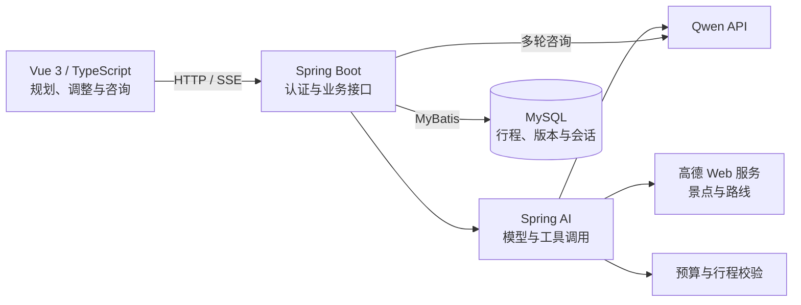

# 旅游规划智能助手

面向自由行用户的旅游规划应用。输入目的地、天数、预算和偏好后，智能体结合景点与路线信息生成行程草稿；用户可以调整局部安排、确认保存，并围绕行程继续咨询。

**技术栈：Vue 3 · TypeScript · Spring Boot · Spring AI · Spring Security · MyBatis · MySQL · Qwen API · 高德 Web 服务 · SSE · Docker Compose**

[功能介绍](#核心功能) · [技术架构](#技术架构) · [快速开始](#快速开始) · [评测结果](#评测结果) · [运行说明](docs/RUNNING.md)

## 核心功能

- **智能规划：**Spring AI 管理模型与工具调用，结合景点查询、路线查询、预算核算和行程校验生成规划草稿。
- **多种出行方式：**支持步行、公交和自驾；配置高德 Web 服务 Key 后，可查询目的地景点与相邻景点的路线、距离和耗时。
- **行程约束：**检查预算分项、每日安排、游览和交通耗时；根据用户提供的参考值检查门票预留与最短游览时间，并将问题反馈给模型修正。
- **局部调整：**选择一天或指定时段修改，后端保留其他活动并重算受影响路段；用户确认后保存为新版本。
- **持续咨询：**围绕已保存行程进行多轮问答，通过 SSE 展示流式回复，支持停止和重新发送。
- **账号与版本管理：**使用 Spring Security 管理登录与数据隔离，MySQL 保存行程、历史版本和会话记录；保存时检查版本冲突。

预算按单人目的地内支出估算，包括住宿、餐饮、门票、当地交通和其他费用。门票价格、开放时间、预约及未来公交班次需要用户另行确认。

## 技术架构



前端负责输入、预览和确认；后端管理任务、工具调用、约束校验与保存。智能体提交的草稿需要通过服务端检查，由用户确认后写入数据库。模型和地图请求设置了调用上限、超时及取消机制。

## 功能演示

以下为行程规划和多轮咨询页面示例。

| 输入出行要求 | 查看行程并继续咨询 |
| --- | --- |
|  |  |

<details>
<summary>查看行程详情与历史记录</summary>


</details>

## 快速开始

准备 Docker Engine、Docker Compose 和兼容 OpenAI 接口的模型 API Key：

```bash
git clone https://github.com/vaegod/travel-planning-assistant.git
cd travel-planning-assistant
cp deploy/compose.env.example deploy/compose.env
```

在 `deploy/compose.env` 中填写 `LLM_API_KEY`、`DB_PASSWORD` 和 `MYSQL_ROOT_PASSWORD`。如需真实景点和路线查询，在高德开放平台申请 **Web 服务 Key**，填入 `AMAP_API_KEY`。

```bash
docker compose --env-file deploy/compose.env up -d --build --wait
```

打开 [https://localhost:8443](https://localhost:8443)，注册账号并选择“试试智能规划”。首次访问需要信任 Caddy 的本地 CA，详细步骤和开发环境配置见 [运行说明](docs/RUNNING.md)。智能规划的操作、参数和数据范围见 [智能体使用说明](docs/AGENT.md)。

未配置高德 Key 时，智能体仍可使用预算与行程校验；地点及路线信息会标记为未核实的估算。模型 API 和高德 Web 服务需要网络访问，具体额度以服务商配置为准。

## 评测结果

基于 ChinaTravel 需求与景点数据设计单人目的地内规划场景，使用独立程序检查预算、地点、交通时间、每日安排及局部修改范围。下表为 20 条独立场景的首次评测结果：

| 检查项 | 同模型一次生成 | 工具调用智能体 |
| --- | ---: | ---: |
| 可行行程满足全部约束 | 3/18 | 18/18 |
| 不可行请求正确拒绝 | 1/2 | 2/2 |
| 平均模型请求数 | 1.00 | 2.10 |
| 端到端耗时 P50 | 25.14 秒 | 34.28 秒 |

两组使用相同模型、参数和参考事实；一次生成调用模型一次，智能体可调用工具并根据校验反馈修正，因此模型调用次数不同。耗时包含任务等待与评测节流。两条不可行场景只评估拒绝决定与原因类别。

评测使用固定景点参考数据和**离线模拟路线**，样本量较小；结果反映本项目在这些约束下的表现，不代表实时高德路线质量或 ChinaTravel 官方成绩。[评测方法与完整报告](eval/agent-v1/README.md) · [数据来源与归属](eval/agent-v1/ATTRIBUTION.md)

## 测试

前端测试、类型检查和构建：

```bash
cd travel-h5-java
npm ci
npm test
npm run build
```

后端使用独立的 `travel_ai_test` 数据库，配置 `DB_TEST_URL`、`DB_USERNAME` 和 `DB_PASSWORD` 后执行：

```bash
cd travel-java-server
./mvnw verify -B -ntp
```

独立评分器与评测数据的离线检查见 [评测说明](eval/agent-v1/README.md)。[GitHub Actions](https://github.com/vaegod/travel-planning-assistant/actions) 运行前后端测试、评测检查与容器部署验证。

## 项目结构

```text
travel-h5-java/       Vue 前端
travel-java-server/   Spring Boot 后端、智能体与数据库迁移
eval/agent-v1/       评测数据、独立评分器与结果
scripts/             开发与验证脚本
deploy/              Dockerfile、Caddy 与配置示例
docs/                使用说明与功能截图
compose.yaml         本机容器编排
```

项目基于公开旅游项目二次开发，完善了用户隔离、行程版本、智能规划、多轮咨询和本机部署能力。
